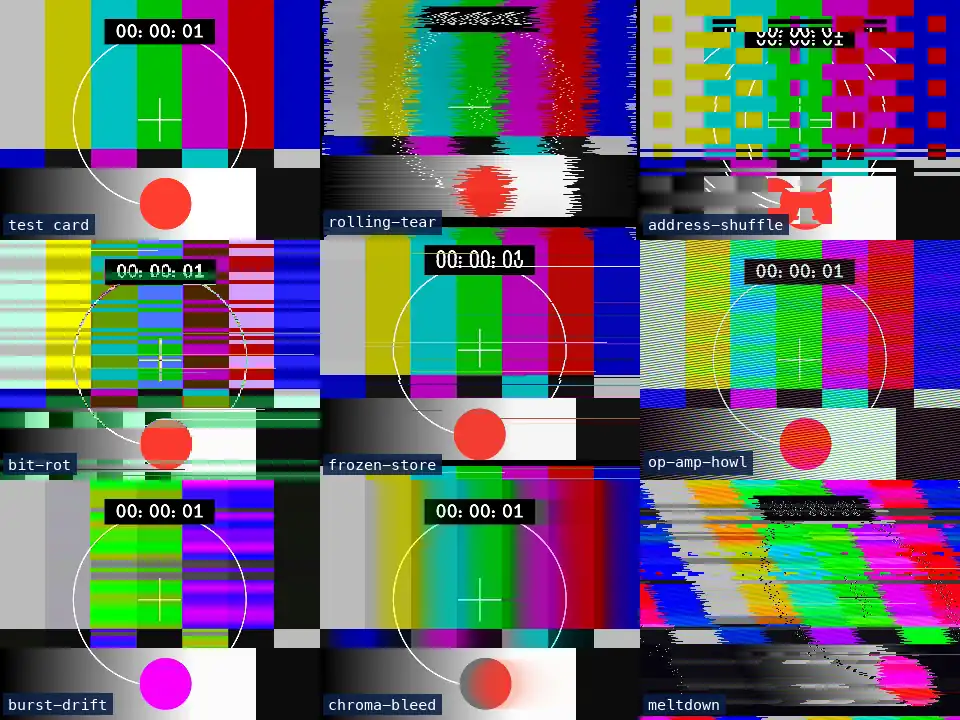
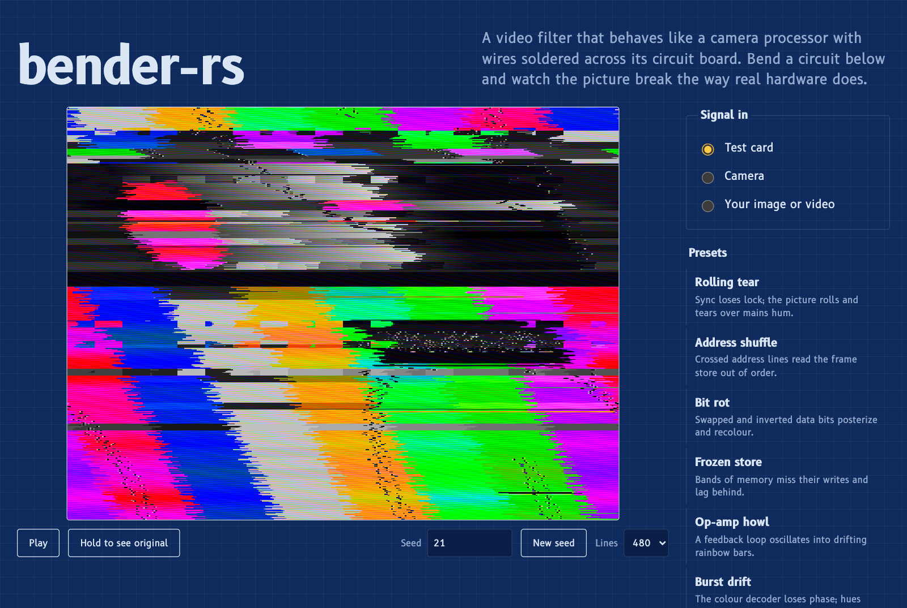
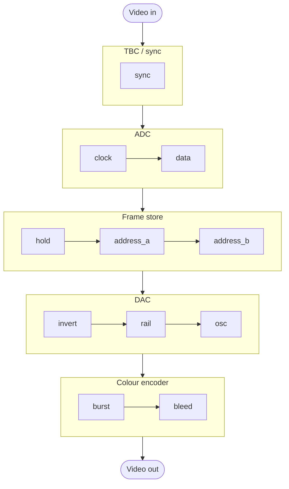

# bender-rs

[](https://github.com/kylegrantlucas/bender-rs/actions/workflows/ci.yml)
[](https://kylegrantlucas.github.io/bender-rs/)
[](https://github.com/kylegrantlucas/bender-rs/releases/latest)
[](#license)
[](https://www.rust-lang.org/tools/install)

bender-rs is a video filter that imitates circuit bending, the practice of soldering wires across a camera processor or video mixer until the picture tears, rolls, smears and changes colour. Each bend models one stage of an analog-to-digital video path, from the sync separator to the colour decoder, and breaks it the way a stray wire would.



<sub>Top left is the unbent test card. The other tiles are the bundled presets, each rendered from that clip with `bender --preset presets/<name>.json`.</sub>

## Try it in your browser

The [demo site](https://kylegrantlucas.github.io/bender-rs/) runs the effect as WebAssembly on a test card, your webcam, or your own image or video. Switch bends on along the signal path, tune them, and copy the matching `bender` command to render a full-length file with sound.

[](https://kylegrantlucas.github.io/bender-rs/)

## What's included

- `bender`, a command-line renderer for videos and images
- `bender-gui`, a desktop app with a live preview and a render button
- the effect core, a plain Rust library with no media dependencies, which also runs the browser demo

## Install

### Prebuilt binaries

Download the archive for your platform from the [latest release](https://github.com/kylegrantlucas/bender-rs/releases/latest). Builds exist for Linux (x86_64 and arm64) and macOS on Apple silicon. Each archive has `bender`, `bender-gui`, the bundled presets and the licenses.

Both programs use GStreamer to decode and encode media, so install it first.

macOS (Homebrew):

```sh
brew install gstreamer
```

Debian and Ubuntu:

```sh
sudo apt install gstreamer1.0-plugins-base gstreamer1.0-plugins-good \
  gstreamer1.0-plugins-bad gstreamer1.0-plugins-ugly gstreamer1.0-libav
```

On other distributions, install the GStreamer base, good, bad, ugly and libav plugin sets. If a plugin is missing, `bender` names the element and the package it comes from.

The macOS binaries are not signed. If Gatekeeper refuses to open them, clear the quarantine flag:

```sh
xattr -d com.apple.quarantine bender bender-gui
```

### From source

You need Rust 1.96 or newer and the GStreamer development headers (`libgstreamer1.0-dev` and `libgstreamer-plugins-base1.0-dev` on Debian and Ubuntu; Homebrew's `gstreamer` already includes them).

```sh
cargo install --locked --git https://github.com/kylegrantlucas/bender-rs bender-cli
cargo install --locked --git https://github.com/kylegrantlucas/bender-rs bender-gui
```

With Nix, `nix develop` gives you a shell with the toolchain, GStreamer and every plugin.

## Usage

### Command line

Render a video with one of the bundled presets:

```sh
bender --preset presets/meltdown.json -i input.mp4 -o bent.mp4
```

The output extension picks the format: `.mp4` is H.264 with AAC audio, `.mkv` is lossless FFV1 with FLAC audio, and `.png` renders a still. Images work as input too.

Change individual settings with `--set`, which you can repeat. It applies on top of a preset, or on top of the defaults if you leave the preset out:

```sh
bender -i input.mp4 -o bent.mp4 \
  --set sync.enabled=true --set sync.v_roll=0.3 \
  --set burst.enabled=true --set burst.phase=90
```

Other useful flags:

| Flag | What it does |
| --- | --- |
| `--list-settings` | Print every setting with its range, default and a description |
| `--dump-preset` | Print the combined preset as JSON instead of rendering |
| `--seed N` | Pick a different random pattern for the same settings |
| `--scanlines N` | Process at N lines of height, 480 by default; 0 keeps the source resolution |
| `--quantizer N` | H.264 quality from 0 to 51, lower is better; 18 by default |
| `--codec h264\|ffv1\|png` | Override the format chosen from the extension |
| `--overwrite` | Replace an existing output file |

Run `bender --help` for the full list.

Settings measured in pixels and rows, such as sample hold, address bits and band heights, apply at the processing size. The same preset looks coarser at `--scanlines 240` and finer at `--scanlines 0`.

### Desktop app

```sh
bender-gui            # then use "Open…"
bender-gui clip.mp4   # or open a file directly
```

The app plays the source through the effect while you adjust it, with sound. It loads and saves the same JSON presets as the CLI, and its render panel writes the same formats.

## The bends

The effect runs these stages in order, grouped here by the part of the hardware they model. Each is off until you enable it.



| ID | Circuit | What goes wrong |
| --- | --- | --- |
| `sync` | Sync separator | Lines lose horizontal lock and tear, and the picture rolls |
| `clock` | Pixel clock | Samples are held across pixels, the sample rate stretches and the clock stalls |
| `data` | Data bus | Bits of each 8-bit sample are swapped or stuck high or low |
| `hold` | Memory hold | Bands of rows keep the previous frame |
| `address_a`, `address_b` | Address bridges | Frame-store address bits are forced or combined, which shuffles blocks of the image |
| `invert` | Inversion | Luma or chroma inverts, I and Q swap, or the image solarizes |
| `rail` | Rail sag | Bright lines dim and shrink, highlights streak and mains hum rolls through |
| `osc` | Oscillation | A self-oscillating op-amp draws drifting diagonal bars |
| `burst` | Colour burst | Hue shifts and wobbles, saturation swings and colour drops out |
| `bleed` | Chroma bleed | Colour smears to the right of edges and slips out of register with luma |

`bender --list-settings` documents every parameter.

## Presets

A preset is a JSON file with a seed and one block per bend. Blocks you leave out stay disabled, and out-of-range values are clamped.

```json
{
  "version": 1,
  "seed": 3,
  "sync": { "enabled": true, "h_skew": 0.0, "h_jitter": 0.035, "tear_rate": 0.45, "v_roll": 0.35 },
  "rail": { "enabled": true, "sag": 0.35, "streak": 0.4, "hum": 0.5 }
}
```

That is `presets/rolling-tear.json`. The directory has a few other starting points: `address-shuffle`, `bit-rot`, `burst-drift`, `chroma-bleed`, `frozen-store`, `meltdown` and `op-amp-howl`. The demo site, the desktop app and `--dump-preset` all write this format.

## Using the library

The `bender` crate has no media dependencies. Give it RGBA8 or YIQ frames with a frame number, and keep one `BendState` per stream: it holds the emulated frame store that memory hold reads back from. For GStreamer pipelines written in Rust, `bender-gst` provides the effect as an element, `BenderFilterElement`.

| Crate | Contents |
| --- | --- |
| `crates/bender` | Effect core: settings, presets and the processing stages |
| `crates/bender-gst` | GStreamer filter element, decoding, preview and render pipelines |
| `crates/bender-cli` | The `bender` command |
| `crates/bender-gui` | The `bender-gui` desktop app (egui) |
| `crates/bender-wasm` | WebAssembly exports used by the demo site |

## Development

`nix develop` sets up everything. Without Nix, install Rust, GStreamer with its development headers, `just`, and the `wasm32-unknown-unknown` target if you work on the site.

```sh
just check        # rustfmt, clippy and the test suite
just cli -i in.mp4 -o out.mp4 --preset presets/bit-rot.json
just gui
just fixture      # write test inputs to /tmp/bender-in.mp4 and /tmp/bender-in.png (needs ffmpeg)
just site-serve   # build the demo into site/dist and serve it on http://127.0.0.1:8471
```

The demo site is static HTML and JavaScript around the `bender-wasm` module. Pushes to `main` deploy it to GitHub Pages.

### Releasing

Bump `version` in the root `Cargo.toml`, commit, then push a matching tag:

```sh
git tag v0.2.0
git push origin v0.2.0
```

The release workflow builds the Linux and macOS archives, checks that the tag matches the crate version, and publishes a GitHub release with checksums.

## License

Licensed under either the [MIT license](LICENSE-MIT) or the [Apache License, Version 2.0](LICENSE-APACHE), at your option.
